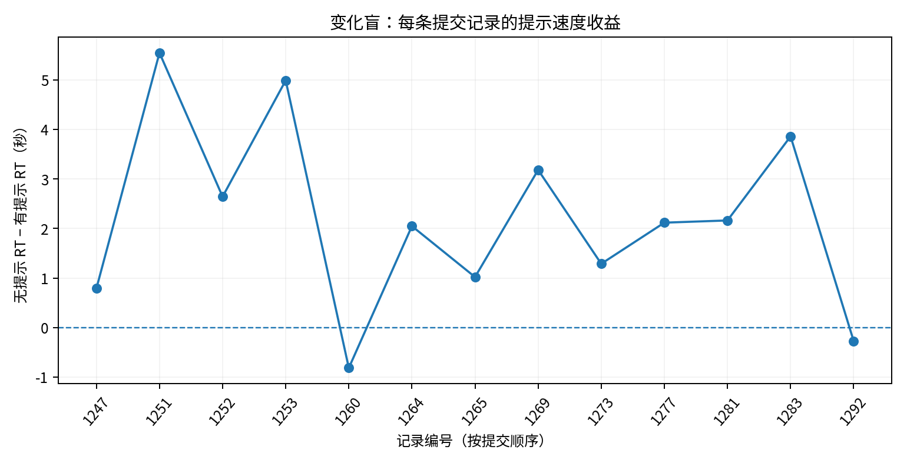
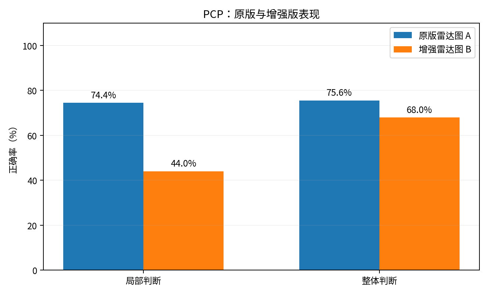
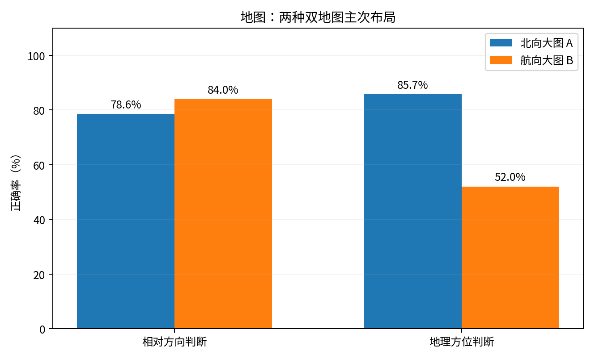

# 见微·注意实验室：作业二数据分析报告（修订版）

**数据来源**：老师HW2收数平台项目 `758X3E` 导出的 `hw2_758X3E_2026-11-09_000739.csv`、`hw2_758X3E_2026-11-09_000742.json`。
**修订原因**：研究者确认部分同学误选了“测试模式”，且匿名编号存在重用或误填，故更正此前“排除全部 `test_`、重复编号仅保留一条”的筛选口径。数据未被修改或补造。

## 1. 数据筛选与特殊情况（应写入最终README）

从平台导出的**42条实验提交（840个试次）**中，仅排除自动化程序 WorkBuddy 于 **2026-11-08 22:08–22:09** 在本地测试地址上传的3条：`record_id=1233` (`test_change`)、`1234` (`test_pcp`)、`1235` (`test_map`)。三条记录的答题反应时异常短、来源为 `http://127.0.0.1:8765`，并有WorkBuddy技术验收报告确认系机械作答。

研究者事后核实：**当晚23:00之后由课程网页提交的 `test_` 数据，实际为同学参加课程实验时误选测试模式产生**。故在研究者确认的前提下，将以下5条重分类为对应实验的正式收数记录，保留原始 `experiment` 值不变：

| 记录号 | 上传时间 | 原始标识 | 分析归类 | 匿名编号 |
|---|---|---|---|---|
| 1248 | 23:15:51 | `test_pcp` | `pcp` | 01 |
| 1273 | 23:42:16 | `test_change` | `change` | 04 |
| 1276 | 23:45:38 | `test_pcp` | `pcp` | 04 |
| 1280 | 23:48:06 | `test_map` | `map` | 04 |
| 1281 | 23:48:40 | `test_change` | `change` | 07 |

**重复编号的提交全部保留**，例如 `pcp-01`（1248、1249）、`change-11`（1277、1283）、`map-01`（1250、1287）、`pcp-11`（1285、1290）。由于有编号误填情况，不能确定相同编号是否一定对应同一个人；这些提交可以作为真实作答记录纳入描述性分析，但**不得把重复提交自动算作不同的独立被试**。实际独立被试人数无法仅凭此导出文件精确核实。

**最终纳入39条真实作答记录、780个正式试次**：变化盲13条260试次、PCP14条280试次、地图12条240试次。PCP A组9条、B组5条；地图A组7条、B组5条。`01/02/.../8` 等编号仅用于记录匹配，不作为个人身份依据。

统计口径：每条提交先在各任务条件计算正确率和**正确且非超时试次的平均反应时**；再对提交记录的条件均值等权平均。正确率包括错误/超时作为错误。敏感性分析将同一个实验中相同规范化编号（如`8`和`08`）的多次提交先取均值，再按编号计算，**仅把编号作为不完全可靠的聚类代理**。所有检验仅作探索性解读，不能将试次或重复提交当作独立被试。

## 2. 三个实验结果

### W5 变化盲：任务相关注意提示

| 条件 | 提交数 | 正式试次 | 正确定位数 | 正确率 | 正确试次平均RT |
|---|---:|---:|---:|---:|---:|
| 有效类别提示 | 13 | 130 | 115 | 88.5% | 2559 ms |
| 无提示 | 13 | 130 | 117 | 90.0% | 4755 ms |

有效提示条件比无提示条件**平均快 2196 ms（约2.20秒）**。13条记录中有11条呈现速度收益。按规范化编号先合并重复提交后，配对差均值为2130ms（12个编号；双侧精确符号翻转检验 `p=0.0034`，探索性）。但正确率为88.5% vs 90.0%，有提示反而低约1.5个百分点；正确率差的探索性检验 `p=1.000`。

**解释**：结果支持H1“提示能缩短变化检测时间”的方向，不支持“提示提高定位正确率”。这与Rensink等（1997）关于言语线索有助于变化觉察的发现方向一致，但本作业使用自行绘制的交通场景，不具备原文完全相同的刺激条件，不能直接比较效应大小。

### W6 PCP：增强雷达图

A组是统一颜色的**原版雷达图**；B组是为六项指标增加固定颜色与标签的**增强雷达图**。每条提交均含局部（focus）10次、整体（global）10次。

| 任务 | A组原版（9条）正确率 | B组增强（5条）正确率 | A组正确RT | B组正确RT |
|---|---:|---:|---:|---:|
| 局部判断 | 74.4% | 44.0% | 1479 ms | 2515 ms |
| 整体判断 | 75.6% | 68.0% | 1106 ms | 1573 ms |

增强雷达图在局部判断中正确率比原版**低约30.4个百分点**，而且平均反应时更长约1.04秒；整体判断中也没有表现出优势。这与H2a预测（增强编码改善局部判断）相反。按规范化编号合并重复提交后，局部正确率差（B−A）仍为约−32.4个百分点（7 vs 5个编号，双侧穷举置换检验 `p≈0.078`，探索性）。

**解释**：不能声称增强显示有效；增加颜色及标注未必降低信息检索负担，还可能增加视觉复杂度。原研究Wickens与Andre（1990）讨论了显示编码对局部/整合任务的权衡，但本作业的任务刺激与研究场景不同，结果只支持针对当前设计的谨慎讨论。此外A、B组实际提交数量不平衡且编号有误填。

### W8 地图朝向：双地图主次布局

A组为**北向上大地图＋航向上小地图**；B组为**航向上大地图＋北向上小地图**。每条提交含相对方向（ego）与世界中心地理方位（world）各10次。

| 任务 | A组正确率（7条） | B组正确率（5条） | A组正确RT | B组正确RT |
|---|---:|---:|---:|---:|
| 相对方向判断 | 78.6% | 84.0% | 1135 ms | 938 ms |
| 世界中心方位判断 | 85.7% | 52.0% | 1161 ms | 2059 ms |

在相对方向判断中，B组平均快约**197ms**，正确率高约5.4个百分点，与H3a预测方向一致；世界中心方位判断中，A组正确率高约**33.7个百分点**，平均快约**899ms**，与H3b预测方向一致。

**解释**：主图朝向与当前任务的参照系相匹配，可能有利于任务表现；该方向与Tlauka等（2000）关于自我中心与世界中心参照系的双地图研究一致。由于组别较小、存在不平衡，且编号错误、重复提交等因素可能造成依赖性，不能声称已经充分证明某布局更优；原作业也没有同批单地图对照，因此不得声称本设计已经优于老师的单地图。

## 3. 数据质量、稳健性与局限

1. **摄像头眼动数据质量**：共有8条纳入记录（3条变化盲、1条PCP、4条地图）的全部20个试次均标记`low_quality=true`。这些记录仍保留用于行为正确率与反应时分析，但**不对眼动注视位置、热图或AOI作可靠性结论**；鼠标兜底模式也不能与真实眼动混合。
2. **异常反应时**：地图记录`1274`中1条正确的相对方向判断只有26ms（明显不符合一般作答过程），主分析依照“保留所有真实作答”的要求未删除；若仅在RT指标中排除小于200ms的该试次，B组相对方向平均RT从约938ms变为约950ms，主要方向不变。此处为敏感性分析，非删除被试。
3. **重复提交及编号误填**：本报告所有39条真实提交均纳入描述统计。统计检验只作为探索性说明，未把39次提交宣称为39个独立个体；由于真实身份不能从匿名编号确认，精确独立样本量和置信度存在局限。
4. **去掉5条误选测试模式的数据之后的方向检查**：仅使用34条原本标记正式的提交（仍保留重复记录）时，变化盲的平均速度收益约2.28秒；PCP增强版局部正确率仍低于原版（44.0% vs 71.4%）；地图A组的世界方位正确率仍高于B组（83.3% vs 52.0%）。三项主要方向并未因重新分类而改变。
5. **研究设计限制**：题目按任务分块，组间被试数较少；可能存在练习、疲劳、分组与先前经验的混淆。PCP“整体判断”实际上可以通过逐项找异常完成，理论上不完全等同多指标整合；自制刺激与原文不能进行严格数量对照。

## 4. 结论

变化盲的任务相关线索在现有数据中呈现较稳定的**速度收益**；PCP增强式颜色编码没有实现预计的局部判断改善，反而表现更差；地图朝向实验呈现出**任务依赖的主图布局优势趋势**。这些结果具有课程作业探索性价值，但因样本量、重复提交、匿名编号不可靠和眼动质量限制，不宜作强因果或普遍化结论。

## 5. 参考文献及来源

- Rensink, R. A., O'Regan, J. K., & Clark, J. J. (1997). To see or not to see: The need for attention to perceive changes in scenes. *Psychological Science, 8*(5), 368–373. https://doi.org/10.1111/j.1467-9280.1997.tb00427.x
- Wickens, C. D., & Andre, A. D. (1990). Proximity compatibility and information display: Effects of color, space, and objectness on information integration. *Human Factors, 32*(1), 61–77. https://doi.org/10.1177/001872089003200105
- Tlauka, M., Stanton, D., & McKenna, F. P. (2000). Dual displays. *Ergonomics, 43*(6), 764–770. https://doi.org/10.1080/001401300404733
- 工程心理学作业二收数与评分说明：https://attention-lab-production.up.railway.app/hw2
- 原始数据：项目`758X3E`的课程平台CSV、JSON导出；本报告保留原始数据且提供逐条记录的筛选审计表，不修改后台记录。
